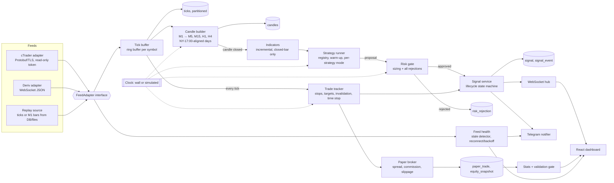

# Forex Signal Platform — Plan (Phase 0)

Status: **Approved; Phase 1 in progress** (started 2026-11-19).
Last updated: 2026-11-18. The rules are in `CLAUDE.md`. Account setup is in `docs/SETUP-ACCOUNTS.md`.

---

## 1. Decisions summary

| Topic | Decision | Why |
|---|---|---|
| Primary feed | **cTrader Open API**, Pepperstone demo account, Protobuf over TLS `demo.ctraderapi.com:5035` | Real bid/ask spot events, trendbar and tick history, CMA-licensed broker in Kenya (Pepperstone Markets Kenya, licence 128), runs on Linux |
| Fallback feed | **Deriv API** over WebSocket (public market-data endpoint, no auth) | Runs on any OS. Also a stand-in while Spotware reviews the Open API app |
| Rejected | MT5 Python package | Windows-only. Linux needs Wine plus an RPyC bridge, which is fragile on a server |
| OAuth scope | **`accounts` (read-only)** | Enforces SIGNALS ONLY at the broker, not just in our code |
| Engine | **Java 25 LTS** + **Maven 3.9.x** (wrapper, pinned; ADR 0007) | Your strongest stack; Maven matches your other Java projects. First-class Protobuf support. JDK 24+ removed virtual-thread pinning on `synchronized` (JEP 491) |
| Database | Percona Distribution for PostgreSQL 18 + Flyway | Your choice. Monthly native partitioning for ticks and candles |
| Dashboard | React + TypeScript + Vite, WebSocket | Your stack |
| Alerts | Telegram Bot API (outbound, with a chat-ID allowlist) | |
| Config | `conf.xml` with CLEARTEXT → ENCRYPTED rewrite, AES-256-GCM, key file | Your pattern, details in §10 |
| Time | UTC in storage and code; EAT (Africa/Nairobi) in the UI and Telegram; IANA zones for sessions | Daylight saving shifts London and New York against EAT |

Feed caveats to design around:
- cTrader: 50 req/s for live calls, **5 req/s for history** per connection. Heartbeat at least every 10 s. Tick-history requests cover at most **1 week** and are paged (`hasMore`). Trendbars only exist for periods that had ticks. Weekend maintenance can happen. The access token lasts about 30 days and the refresh token does not expire.
- Deriv: 220 calls/min and 14,400/hr for most calls. The **old API is being retired** and the new one is incompatible, so we build only against the new API. `frx*` prices are Deriv's own quotes, so results are **tagged by feed and never pooled**.

## 2. Symbols

| Symbol | Role | cTrader (Pepperstone) | Deriv fallback |
|---|---|---|---|
| EURUSD, GBPUSD, USDJPY, AUDUSD | Signal (all strategies) | Checked at startup | `frxEURUSD` etc., checked via `active_symbols` |
| XAUUSD, XAGUSD | Signal (trend and breakout only) | Checked at startup | `frxXAUUSD`, `frxXAGUSD` if listed, otherwise optional |
| USDX | **Context only** (USD-strength filter) | Pepperstone lists a USDX currency-index CFD with an average spread of about 5.2 points. **Whether it's on cTrader is not yet confirmed** | Not expected → optional. If missing, the synthetic index in §7.4 is used (approved) |
| USDCAD, USDSEK, USDCHF | **DATA_ONLY**: inputs to the synthetic index; never signals, sizing or exposure | Checked at startup | `frx*` if listed, otherwise optional |

Roles: `SIGNAL` (strategies may trade it), `CONTEXT` (strategies may read it; it's never traded), `DATA_ONLY` (stored and used only to compute derived series). The risk gate rejects anything that isn't `SIGNAL` (`CONTEXT_ONLY_SYMBOL`).

**Symbol check at startup** (all feeds): the adapter loads the broker's symbol list and contract details (digits, pip position, lot size, min volume, volume step, trading hours, swap, commission where available). It stores them in `symbol_spec` and compares them with `conf.xml`. Then:
- If a **required** symbol is missing, the app fails to start with a clear message. If an **optional** one is missing, it logs a warning, sends a Telegram notice and continues.
- If a spec differs from the last stored version, it writes a `symbol_spec` history row and sends an alert, because changed specs silently corrupt position sizing.
- USDX stays `context_only=true` until you set `verified=true` in config after reviewing its spec.

## 3. Account and costs

Demo account: **USD 10,000, Razor, cTrader** (approved). The Standard account is kept only as an alternative `cost_profile` for comparison.

**Commission** is configured **per side, per lot, per instrument class**, and each symbol can override its class:

| Class | Per side, per lot (USD) | Source | Status |
|---|---|---|---|
| FX | 3.00 | Pepperstone pricing: "6 USD roundtrip per unit" on cTrader | Published |
| XAUUSD | 3.50 | Third-party site says USD 7 round turn; Pepperstone pricing page lists commission on XAU/USD | Probable |
| XAGUSD | **unknown** | Not published | **Must verify** |

The verification process:
1. At startup the cTrader adapter reads each symbol's own commission fields (rate and type: per lot, per million USD or percentage). It stores them in `symbol_spec` and logs any difference from `conf.xml`.
2. **Cross-check:** after you place one manual 0.01-lot test trade per symbol on the demo account, compare the commission on your statement with the configured value. This is a Phase 3 checklist item. The statement figure wins, and the config is updated to match.
3. Lots below 1.0 are charged pro rata. Pepperstone's site returns 403 to automated fetches, so its current page has to be checked by hand once. That's on the Phase 1 checklist.

Cost model applied everywhere (backtest, replay, paper):
- **Spread:** the actual bid/ask when ticks are available. Historical M1 bars are bid-only, so backtests use the **measured median spread for that symbol and session bucket** from `spread_stats`. Live spread recording starts as soon as a feed is connected (Phase 1), before any strategy exists.
- **Commission:** see the table above. It's charged on entry and on exit.
- **Slippage**, set per symbol in price units:
  - FX majors: **0.2 pips**, stored as price (0.00002, or 0.002 for JPY pairs).
  - Metals in **price units**: **XAUUSD 0.15**, **XAGUSD 0.02**.
  - Multipliers: **×2 outside the London and NY sessions**, **×3 inside a news blackout window** (only matters if a signal is ever allowed there, e.g. an exit). They don't stack beyond ×3.
  - It's applied against us on entry, stop, time-stop and invalidation exits. Target exits get no positive slippage.
- **Entry latency:** you'll place trades by hand, so the paper fill is the **first tick at or after the alert time + 10 s** (configurable `entryLatencySec`), at the ask for longs or bid for shorts, plus slippage. In M1-bar backtests, the fill is the synthetic tick at or after the latency time. With 10 s that's normally the next bar's open, at its modelled ask. Stop and target are kept **at their price levels** (not moved for the fill), so latency changes the actual R. That's deliberate.
- **Cost stress (validation gate):** spread ×1.5, slippage ×2 on top of the session and news multipliers, latency unchanged.
- **Swap:** read from the spec and applied to positions held over the 17:00 NY rollover.
- **Cost reality check:** with a 1.5×ATR(M15) stop on EURUSD (often 8–12 pips), commission alone is about 0.6 pips round turn, which is **~0.05–0.08R per trade before spread and slippage**. A +0.10R-after-costs gate is therefore demanding at M15. That's intended, but expect some baselines to fail it.

## 4. Architecture



**One engine, three modes.** `live`, `replay` and `backtest` all build the same `Engine` object with the same components. They differ in only two places:
- **Clock:** `WallClock` for live. `SimulatedClock` for replay and backtest, which advances using event timestamps.
- **FeedAdapter:** the cTrader or Deriv adapter for live, `ReplaySource` for the others.

Replay is backtest with pacing (1x, 10x, 60x or max speed) and live outputs (WebSocket, optionally Telegram with a `[REPLAY]` prefix). The regression test runs the same input through both and compares the resulting signals and trades field by field.

**Historical input fidelity:**
- **Tick replay** (highest fidelity): recorded live ticks, or cTrader tick history (bid and ask fetched separately and merged). Use it for recent weeks and for the calibration week.
- **M1-bar backtest** (used for multi-year validation; **only M1 is imported**, and every higher timeframe is derived from it by the same `CandleBuilder` used live): each M1 bid bar is expanded into four synthetic ticks (O, then the adverse extreme, then the favourable extreme, then C). The order is worst-case for any open position. The ask is the bid plus the spread model. This is conservative: if the stop and the target fall in the same M1 bar, **the stop wins**. We report how often this ambiguity occurred.
- Storage: recorded ticks go in Postgres (monthly partitions, 90-day retention by default). Bulk history goes in `data/` as zstd CSV per symbol per day (gitignored), and M1 candles go in Postgres.

**Concurrency:** one virtual thread per feed connection (reader), one for the heartbeat, and a single-threaded **engine event loop** that consumes ticks in timestamp order. That keeps strategy, risk and tracking deterministic. Delivery (WebSocket, Telegram, DB writes) uses separate queues on virtual threads, so a slow Telegram call never stalls the engine.

**Feed health:**
- Reconnect with exponential backoff and jitter (1 s → 60 s max).
- A symbol is "stale" if it gets no tick for N seconds while its market should be open (N configurable, default 60 s FX and 120 s metals), checked against the spec's trading hours, so weekends don't alert.
- On a stale symbol or a disconnect: a `FEED_DOWN` alert goes to Telegram and the UI, signal generation pauses for the affected symbols, and the tracker marks open signals `tracking_degraded`. When ticks return, a `FEED_RECOVERED` alert goes out and missed M1 bars are backfilled from trendbars before strategies resume.
- Metrics: tick lag (broker timestamp vs receive time) at p50/p95/p99, ticks per minute per symbol, reconnect count, and candle-close to signal-delivered latency.

**Repo layout:**
```
pom.xml                 root, packaging=pom: all versions in <properties>, dependencyManagement, pluginManagement, enforcer
mvnw, .mvn/wrapper/     Maven Wrapper (pinned Maven 3.9.16)
engine/                 Java 25 module (engine/pom.xml): shade fat jar forex-signals.jar
  src/main/java/.../config     conf.xml loader + AES rewrite
  .../feed                     FeedAdapter, CTraderAdapter, DerivAdapter, ReplaySource, SyntheticFeed
  .../market                   Tick, Candle, CandleBuilder, SymbolSpec, SessionCalendar
  .../indicator                EMA, ATR, ADX, RSI, Donchian (incremental)
  .../strategy                 Strategy interface, StrategyRegistry
  .../strategy/impl            one file per strategy (auto-discovered)
  .../risk                     RiskGate, PositionSizer, ExposureBook, NewsCalendar
  .../signal                   Signal, SignalService, TradeTracker
  .../paper                    PaperBroker, CostModel
  .../stats                    Metrics, Bootstrap, WalkForward, ValidationGate
  .../delivery                 WebSocketHub, TelegramNotifier
  .../app                      Main (live|replay|backtest|import), HTTP health/metrics
  src/main/resources/db/migration  Flyway SQL
dashboard/              React + TS + Vite
docs/                   PLAN.md, SETUP-ACCOUNTS.md, adr/
inbox/                  (gitignored) transcript workflow, later
data/                   (gitignored) history dumps
docker-compose.yml, Makefile, conf.example.xml
```

## 5. Candles, sessions and time

- **Price basis:** candles are built from the **bid**, which matches cTrader trendbars. Each candle also stores `spread_min/median/max` and `tick_count`.
- **Alignment:** M1, M5 and M15 align to UTC minutes. **H1, H4 and D1 align to the 17:00 New York trading day**, the same day boundary as the daily loss cap and Pepperstone server time (UTC+2/+3). H4 bars open at 17:00, 21:00, 01:00, 05:00, 09:00 and 13:00 New York time, so H4 stays in sync with the broker's charts through daylight-saving changes.
- **Closing a candle:** a bar closes when the first tick of the next period arrives, or when the clock passes the period end plus a grace time (default 2 s), whichever comes first. The second rule stops a quiet market from delaying a close. Late ticks for an already-closed bar are logged and counted, **never applied**, so there's no repainting.
- **Gaps:** periods with no ticks produce **no candle**, which matches cTrader. Indicators skip missing bars rather than inventing flat ones. Weekend and holiday gaps are expected. An unexpected gap during market hours is logged.
- **Sessions:** `SessionCalendar` uses `ZonedDateTime` with `Europe/London` and `America/New_York`. Entries are allowed when either session is open: 08:00–17:00 local time in each zone. The Friday cut-off is no new entries after **15:00 New York time on Friday** (2 hours before the 17:00 close). The UI shows all of this in EAT.
- **Tests:** London and New York daylight-saving changes (including the weeks in March and late October/November when only one has changed), weekend open and close, the Friday cut-off, a gap during market hours, late ticks, and a candle at the exact boundary.

## 6. Spread calibration

- **Recording starts in Phase 1**, as soon as any feed connects, long before strategies exist. Deriv spreads (if it provides bid/ask) are stored separately and never used for cTrader costs.
- **Week 1 (calibration):** record every live tick's spread. `spread_stats` holds the median and p95 per symbol per session bucket (Asia, London, London+NY overlap, NY, rollover). Only the "spread over 15% of stop distance" rule applies, and signals are labelled `UNCALIBRATED`.
- **After calibration:** cap = **2.5 × median** per symbol per session, rebuilt weekly from a rolling 4 weeks of data. Any change is shown on the dashboard.
- The **rollover window** (16:55–17:10 New York time) also gets its own bucket. Spreads blow out there, and this bucket lets the cap reject those signals without loosening the cap for other sessions.

## 7. Strategy interface, strategies and controls

### 7.1 Interface
```java
public interface Strategy {
    StrategyMeta meta();   // name, version, source ("baseline" | video URL), symbols,
                           // entryTimeframe, contextTimeframes, params (Map), warmupBars
    // Called ONLY when a candle of entryTimeframe closes for a symbol in meta().symbols().
    // ctx exposes closed candles and closed-bar indicator values only; no access to the
    // forming bar, to ticks, to the clock beyond ctx.now(), or to other symbols' futures.
    Optional<SignalProposal> onCandleClose(StrategyContext ctx);
    // Called on each closed entryTimeframe candle for every open signal of this strategy;
    // may return an INVALIDATE or EXIT decision with reasons (e.g. H1 ADX rose above 25).
    Optional<ExitDecision> onOpenSignalCandleClose(StrategyContext ctx, Signal open);
}
```
- `SignalProposal` contains: direction, entry type (market at next tick, or a zone), stop, targets[], exit plan text plus machine rules, valid-for-N-bars, an invalidation condition, and `reasons[]`. **It contains no size.** Only the risk gate sets the size.
- Discovery: the registry scans the `strategy.impl` package for classes annotated `@StrategyDef` (using ClassGraph). Adding a strategy means adding one file plus a test.
- Each strategy has a mode in the DB: `DISABLED | SHADOW | LIVE`. A strategy can only move to `LIVE` if its latest `validation_result` passed and was produced by the current `version` plus `params_hash`. Any change to code or parameters requires a new version, which resets it to SHADOW.

### 7.2 Signal object
`id (UUID)`, `strategy`, `strategy_version`, `params_hash`, `feed`, `run_id`, `mode (LIVE|SHADOW|REPLAY|BACKTEST)`, `symbol`, `direction`, `created_at (UTC)`, `candle_close_at`, `valid_until`, `entry {type, price | zone_low, zone_high}`, `stop`, `targets[] {price, r_multiple, close_fraction}`, `exit_plan {text, rules[]}`, `suggested_lots`, `risk_amount_usd`, `risk_pct`, `rr_to_first_target`, `spread_at_signal`, `reasons[] {rule, observed, threshold, passed}`, `invalidation {text, rule}`, `state (PENDING|ACTIVE|CLOSED|EXPIRED|INVALIDATED)`, `filled_price`, `closed_at`, `close_price`, `close_reason (TARGET|STOP|TIME_STOP|EXIT_RULE|INVALIDATED|EXPIRED|KILL_SWITCH|MANUAL)`, `est_cost_r` (at signal time), `gross_r` (price move only, from reference price to exit), `net_r` = `result_r` (after spread, commission, slippage, latency, swap), `result_usd`, `mae_r`, `mfe_r`, `flags[] (UNCALIBRATED, TRACKING_DEGRADED, AMBIGUOUS_BAR)`.

Lifecycle: `PENDING` (approved, waiting for entry) → `ACTIVE` (entry filled on a tick at the ask for longs or the bid for shorts, plus slippage) → `CLOSED`. A PENDING signal can instead become `EXPIRED` (not filled before `valid_until`) or `INVALIDATED`. Every transition writes a `signal_event` row.

### 7.3 Baseline strategies (approved, revised against your checklist)

**Rules every strategy follows:**
- **Signal on close, never fill at the close.** A strategy runs only when an M15 candle closes. The alert goes out at that moment. The fill is the first tick at or after the alert + `entryLatencySec` (10 s) at ask or bid, plus slippage (§3). The signal candle's close price is never used as the fill.
  - Stop and target are **anchored to the reference price** = the ask (long) or bid (short) at alert time, so they're fixed price levels you can type into the broker.
  - If, by fill time, the price has already passed the stop or target, the signal becomes `EXPIRED` (reason `MOVED_BEFORE_FILL`) and is not filled.
- **One shared parameter set**, ATR-normalised, identical for every symbol. No per-symbol tuning anywhere in the code (a test checks that strategy params don't vary by symbol).
- **Each strategy defines all five exits:** stop, target, trailing rule, time stop and invalidation. "Trailing: none" is a deliberate, stated rule, not an omission.
- **The "why" list** records every rule checked at the signal, including the ones that passed: `{rule, observed, threshold, passed}`, e.g. `{rule:"H4 close > EMA50(H4)", observed:1.08734, threshold:1.08410, passed:true}`.
- **R:R check:** the gate measures R:R on price distances from the reference price (spread-inclusive, because the reference is the ask or bid). Commission and slippage are excluded from that check but included in `result_r`.
- **Indicator definitions:** EMA uses the standard 2/(n+1) smoothing, seeded with an SMA. ATR, ADX and RSI use **Wilder's smoothing**. All are computed on closed bid candles. Warm-up = 3× the longest period on that timeframe, plus 10 bars. No signals until warm.
- Higher timeframes are derived from M1 (§5). An H1 or H4 value means the **last closed** H1/H4 bar at the moment the M15 bar closes, never the forming one.

**Shared parameters (defaults and reasons):**

| Param | Default | Why |
|---|---|---|
| `atrPeriod` | 14 | Wilder's standard. Long enough to smooth single spikes, short enough to adapt within a session |
| `stopAtr` | 1.5 | Outside typical M15 noise (about 1 ATR), and keeps spread + commission at or below roughly 10–15% of the stop on majors |
| `emaFast` / `emaSlow` (M15) | 20 / 50 | Widely used pair; defines a short-term trend and its pullback zone without being optimised |
| `emaTrend` (H1, H4) | 50 | About 2 days (H1) or 8 days (H4) of trend context |
| `pullbackTouchAtr` | 0.25 | Counts a "touch" of EMA20 within a quarter ATR, so near-misses on wide-spread symbols aren't ignored |
| `slopeBars` (H1) | 5 | Slope of EMA50 over 5 closed H1 bars, a minimal noise filter |
| `donchianEntry` | 20 | Classic 20-bar breakout (Turtle-style), about 5 hours on M15 |
| `donchianTrail` | 10 | Half the entry lookback, the classic exit channel |
| `atrRegimeLong` | 100 | ATR(100) as the "normal volatility" baseline, about 1 day on M15 |
| `volRatioMin` / `Max` | 0.8 / 2.0 | Skip dead markets (<0.8) and news-spike conditions (>2.0) |
| `rsiPeriod` | 14 | Wilder's standard |
| `rsiLow` / `rsiHigh` | 30 / 70 | Standard oversold and overbought levels; not tuned |
| `adxPeriod` | 14 | Wilder's standard |
| `adxRange` | 20 | Below 20 is the conventional "no trend" reading (your requirement) |
| `adxInvalidate` | 25 | Conventional "trend present" reading; the gap from 20 avoids flip-flopping |
| `beAtR` | 1.0 | Move the stop to breakeven once +1R is reached (trend strategies) |
| `trailAtr` | 2.5 | Chandelier trail distance; wider than the initial stop so normal pullbacks don't hit it |

**(a) EMA trend pullback**: FX majors plus XAUUSD and XAGUSD.
- *Context* (long; short is the mirror): last closed H4 close > EMA50(H4), **and** EMA50(H1) now > EMA50(H1) 5 bars ago.
- *Setup:* M15 EMA20 > EMA50, and in the last 3 closed M15 bars some low ≤ EMA20 + 0.25×ATR14.
- *Trigger:* the closed M15 bar has close > EMA20 and close > open.
- *Stop:* reference − 1.5×ATR14(M15). *Target:* reference + 2.0R.
- *Trailing:* at +1.0R, move the stop to breakeven (reference price). After that, a chandelier stop at the highest bid since entry − 2.5×ATR14(M15), updated on M15 closes and only tightening.
- *Time stop:* close at market after 32 M15 bars (8 h).
- *Invalidation:* a closed H1 bar finishes below EMA50(H1). This gives an "exit now" alert.

**(b) Donchian breakout with volatility filter**: FX majors plus XAUUSD and XAGUSD.
- *Context:* last closed H4 close on the breakout side of EMA50(H4).
- *Filter:* 0.8 ≤ ATR14/ATR100 (M15) ≤ 2.0.
- *Trigger:* M15 close > highest high of the 20 **previous** closed bars (the signal bar is excluded).
- *Stop:* reference − max(1.0×ATR, min(1.5×ATR, reference − lowest low of the last 10 bars)), i.e. the 10-bar low or 1.5 ATR, whichever is tighter, but never tighter than 1.0 ATR. *Target:* reference + 2.0R.
- *Trailing:* the stop follows the 10-bar Donchian low on each M15 close, only tightening. (This replaces the old "exit rule". A trailing stop is the same idea but is a price you can enter at the broker.)
- *Time stop:* 48 M15 bars (12 h).
- *Invalidation (failed breakout):* within the first 4 bars after entry, an M15 close back below the broken 20-bar level. Gives an "exit now" alert.

**(c) RSI mean reversion in a range**: **FX majors only** (EURUSD, GBPUSD, USDJPY, AUDUSD). Never metals, USDX or the data-only pairs.
- *Regime:* ADX14 on the last closed H1 bar < 20.
- *Trigger* (long): RSI14(M15) on the previous bar < 30 and on the signal bar ≥ 30. Short: > 70, then ≤ 70.
- *Stop:* reference − 1.5×ATR14(M15). *Target:* reference + 1.5R.
- *Trailing:* **none, deliberately.** The 1.5R target is close; breakeven or trailing would cut winners that typically retrace on the way to the mean.
- *Time stop:* 16 M15 bars (4 h). Mean reversion that hasn't worked by then usually means the regime changed.
- *Invalidation:* ADX14 on a closed H1 bar ≥ 25. Gives an "exit now" alert.

**(d) Random-entry controls**: `ema_pullback__random`, `donchian__random`, `rsi_mr__random`.
- Each uses **exactly the parent's** symbols, sessions, stop, target, trailing, time stop, latency and risk gate. The direction is random, and the parent's context rules are not applied.
- Entry timing: on each closed M15 bar, a seeded RNG fires with probability = the parent's signals per eligible bar, measured in the same backtest.
- Invalidation for the controls is the parent's rule applied to the random direction, so the exits are identical in mechanics.
- Gate check #8 (§8) requires the parent to beat its control.

**What changed versus the version you approved, and why:**
1. Entry was "market at next tick". It's now **alert + 10 s latency**, with stop and target anchored to the alert-time price. This follows your latency rule and the "never the close" rule.
2. **(a)** had no trailing rule. I added breakeven at +1R plus a 2.5-ATR chandelier trail.
3. **(b)**'s "close back inside the 10-bar channel" exit became a **10-bar Donchian trailing stop**. A separate failed-breakout invalidation was added, since (b) had none.
4. **(c)** now states "trailing: none" explicitly, and the trigger is a defined cross (previous bar beyond the level, signal bar back inside).
5. **(c)**'s 1.5R target only passes the 1.5 minimum R:R because the R:R check is measured from the spread-inclusive reference price, with commission and slippage excluded. If you'd rather the R:R check also include commission, (c)'s target needs to rise to about 1.6R. **Tell me which you prefer.**
6. **Random controls** now drop the parent's context filters. They keep exits, sessions and the risk gate, so the comparison isolates the entry edge.

### 7.4 USDX context filter
"USD strong" means the last closed H4 index close is above its H4 EMA50.

1. **The broker's USDX**, if it's on cTrader and verified.
2. Otherwise, the **synthetic index** (approved). It uses the ICE formula, a geometric average that has been unchanged since 1999, confirmed against ICE Data Indices and FOREX.com:
   `USDX_syn = 50.14348112 × EURUSD^-0.576 × USDJPY^0.136 × GBPUSD^-0.119 × USDCAD^0.091 × USDSEK^0.042 × USDCHF^0.036`
   - It's computed from **mid prices** on each M1 close, but only when all six inputs have a bar for that minute. Otherwise the last value is carried forward for at most 5 minutes, then marked missing.
   - It's labelled **"USDX_SYN: synthetic, approximates USDX"** everywhere: database `source`, dashboard and the "why" list.
   - Used only as a context filter. Never used for sizing, exposure or signals (role `CONTEXT`, enforced by the risk gate).
3. Otherwise, if USDCAD, USDSEK or USDCHF are unavailable, a **reduced index**, labelled **"USD_STRENGTH_REDUCED: not USDX"**. It's the equal-weight geometric mean of USD strength against EUR, GBP, JPY, AUD (and the price of USD in XAU is excluded, since metals aren't currencies).
   - Formula: `exp(mean(ln(1/EURUSD), ln(1/GBPUSD), ln(USDJPY), ln(1/AUDUSD)))`, rebased to 100 at the series start.

The filter is **off by default** and gets added as its own strategy version (e.g. `ema_pullback v1.1-usdx`), so its effect is measured, not assumed.

## 8. Validation gate (your rules, made exact)

Calculated per strategy version, pooled across its symbols, on **after-cost** R results:

| # | Check | Pass condition |
|---|---|---|
| 1 | Sample | ≥ 200 trades over ≥ 12 months that include at least one trending and one ranging period, judged by H4 ADX percentiles. The regimes covered are reported. |
| 2 | Expectancy | Mean R ≥ +0.10 **and** the lower bound of a bootstrap 90% CI (10,000 resamples, block bootstrap by week) is > 0 |
| 3 | Drawdown | Max peak-to-trough drawdown of the cumulative R curve ≤ 10R |
| 4 | Profit factor | ≥ 1.2 after costs |
| 5 | Walk-forward | Rolling windows: 12 months in-sample → 3 months out-of-sample, stepped 3 months. All OOS trades pooled: OOS expectancy > 0 and ≥ 50% of IS expectancy, with **≥ 50 OOS trades**, otherwise the result is **INCONCLUSIVE** (counts as a fail for going live) |
| 6 | Cost stress | Re-run with spreads × 1.5 and slippage × 2: expectancy still > 0 |
| 7 | Concentration | No single symbol makes up > 50% of total positive R |
| 8 | Beats chance | Expectancy minus the random control's: the bootstrap 90% CI lower bound is > 0 |

- Results are `PASS | FAIL | INCONCLUSIVE`, with each check's value stored in `validation_result`.
- Every report shows **gross R and net R side by side**, the average cost in R, and a **rejection count by reason**, so "fails on costs" can be told apart from "has no edge".
- **A failing baseline is a result, not a bug.** If an M15 baseline fails on costs (gross expectancy positive, net not), the next step is an **H1-entry variant** (same rules one timeframe up, with H4 and D1 context) before concluding anything, because wider stops shrink the cost drag. It's a new version with the same gate. Nothing gets tuned to make a result pass.
- A PASS moves the strategy from SHADOW to eligible for LIVE (you flip it manually). It is then called "promising" only after **≥ 100 paper-traded live signals**. The dashboard shows a counter for that.
- Since parameters are shared across symbols and not tuned, "in-sample" here means "data seen before the parameters were frozen". I'll record the date parameters were frozen. Any later change to them means a new version, a new history window and a new gate result.
- **Data needed:** with 6 symbols on M15, 200 trades may need 2–3 years of history depending on how often signals fire. I plan to import **3 years of M1 trendbars** plus sampled tick weeks (to model spreads) from cTrader.

## 9. Risk gate (every rejection has a dedicated test)

Position size: `lots = floor_to_step( (equity × 1%) / (|entry − stop| × contract_size × quote_to_USD) )`, using the spec's `volume_step`.
- `quote_to_USD` is the live mid-price conversion. For example, USDJPY uses 1/USDJPY.
- If the result is below the spec's `min_volume`, the signal is **rejected** (`SIZE_BELOW_MIN`). It is never rounded up.
- Expected commission is added to the risk figure.
- Equity is starting balance + realized + floating P/L of the paper book.

Rejection reasons, checked in this order (the first failure is recorded, but all checks are evaluated and stored for visibility):
1. `NO_STOP`: the stop is missing, or on the wrong side of entry.
2. `RR_TOO_LOW`: R:R to the first target, after spread, is below 1.5.
3. `COST_VS_STOP`: estimated **round-trip cost** = current spread + commission (both sides, converted to price per unit) + entry and exit slippage (with session and news multipliers) is **> 15% of the stop distance (0.15R)**. The threshold is configurable (`maxCostR`). This replaces the earlier spread-only 15% rule. The estimate is stored in `checks`.
4. `SPREAD_CAP`: spread above 2.5 × the median for this symbol and session (only after calibration).
5. `OUTSIDE_SESSION`: neither London nor New York is open, or it's after the Friday 15:00 New York cut-off.
6. `NEWS_BLACKOUT`: within ±15 minutes of a high-impact event (±30 for NFP, FOMC, CPI and rate decisions) for any currency involved. Metals and USDX count as USD.
7. `DAILY_LOSS_CAP`: realized plus floating P/L since 17:00 New York is ≤ −3% of the equity at that 17:00.
8. `KILL_SWITCH`: equity has fallen ≥ 10% from its peak. The switch stays tripped until a **manual reset** (dashboard button plus confirmation, written to the audit table). It also sets every open signal to "exit now" alerts.
9. `MAX_OPEN`: 3 signals are already PENDING or ACTIVE.
10. `CURRENCY_EXPOSURE`: each signal counts as long one currency and short another (EURUSD long = +EUR, −USD). XAU and XAG both map to **METALS**. The signal is rejected if any currency or cluster would have more than 2 signals in the same direction.
11. `USD_NET_EXPOSURE`: the absolute net USD count (+1 per short-USD, −1 per long-USD) would exceed 2.
12. `FEED_UNHEALTHY`: the symbol is stale or the feed has been reconnecting in the last N seconds.
13. `CONTEXT_ONLY_SYMBOL`: the symbol's role isn't `SIGNAL` (USDX, USDX_SYN, the reduced index, USDCAD, USDSEK, USDCHF).

(Rule 6 has a variant, `NEWS_BLACKOUT_FALLBACK`, used when the calendar is stale; see §13.)
14. `SIZE_BELOW_MIN`: see the sizing note above.
15. `STRATEGY_NOT_LIVE`: the strategy is in SHADOW mode. The signal is still journaled and tracked, but it isn't delivered.

Approved signals are wrapped in a `RiskApproved<Signal>` type. Only the risk gate can create one, and `SignalService.publish()` only accepts that type. So a strategy has no way to skip the gate.

## 10. Configuration (`conf.xml`)

```xml
<config>
  <database host="localhost" port="5432" name="forex" user="forex">
    <password TYPE="CLEARTEXT">changeme</password>       <!-- rewritten as TYPE="ENCRYPTED" -->
  </database>
  <ctrader host="demo.ctraderapi.com" port="5035" accountId="...">
    <clientId TYPE="CLEARTEXT">...</clientId>
    <clientSecret TYPE="CLEARTEXT">...</clientSecret>
    <accessToken TYPE="CLEARTEXT">...</accessToken>
    <refreshToken TYPE="CLEARTEXT">...</refreshToken>
  </ctrader>
  <telegram chatId="..."><botToken TYPE="CLEARTEXT">...</botToken></telegram>
  <risk riskPct="1.0" dailyLossPct="3.0" killSwitchPct="10.0" maxOpen="3" minRR="1.5" .../>
  <costs profile="pepperstone_razor_ctrader" slippagePipsFx="0.2" slippagePipsMetal="0.3"/>
</config>
```
- On startup, every element with `TYPE="CLEARTEXT"` is encrypted with **AES-256-GCM** (random 12-byte IV per value, stored as `base64(iv‖ciphertext‖tag)`) and the file is rewritten atomically (write to a temp file, then rename) with `TYPE="ENCRYPTED"`.
- Key file: `~/.forexsignals/master.key`, 32 random bytes, created on first run with chmod 600 and owned by the service user. The `FOREXSIGNALS_KEY_FILE` environment variable overrides the path.
- If the key file's permissions are wider than 600, the app refuses to start.
- Refreshed cTrader tokens are written back encrypted.
- `conf.xml` and the key are gitignored. `conf.example.xml` is committed.

## 11. Database schema (Flyway V1, summary)

```
symbol                 (code PK, feed, broker_symbol_id, role SIGNAL|CONTEXT, asset_class, base_ccy, quote_ccy, cluster, verified)
symbol_spec            (id, symbol, feed, digits, pip_position, contract_size, min_volume, volume_step, max_volume,
                        commission jsonb, swap_long, swap_short, trading_hours jsonb, captured_at)   -- history kept
tick                   (symbol, ts timestamptz, bid, ask, feed, recv_ts)          -- PARTITION BY RANGE(ts) monthly
candle_m1              (feed, symbol, open_time, open, high, low, close, tick_count,
                        spread_min, spread_med, spread_max, source BUILT|IMPORT)
                        PRIMARY KEY (feed, symbol, open_time)  -- your (symbol, timestamp) unique rule;
                        -- feed is included because cTrader and Deriv quotes differ and must never be mixed.
                        PARTITION BY RANGE (open_time), one partition per month (auto-created ahead)
candle                 (feed, symbol, timeframe M5|M15|H1|H4|D1, open_time, OHLC, tick_count, spread stats,
                        source DERIVED)  PK (feed, symbol, timeframe, open_time), partitioned monthly
                        -- derived from candle_m1 only; can be truncated and rebuilt at any time
import_progress        (feed, symbol, chunk_start, chunk_end, status PENDING|DONE|FAILED, rows, attempts,
                        last_error, updated_at)  PK (feed, symbol, chunk_start)   -- resumable import
gap_report             (feed, symbol, gap_start, gap_end, minutes, expected BOOLEAN, reason)
                        -- expected = weekend/holiday/daily break per the spec's trading hours
spread_stats           (symbol, feed, session_bucket, window_start, window_end, median, p95, samples)
cost_profile           (name PK, commission_per_lot_side jsonb, default_slippage jsonb, notes)
news_event             (id, ts, currency, title, impact HIGH|MEDIUM|LOW, tier STANDARD|MAJOR, source FEED|CSV, loaded_at)
strategy               (name, version, params jsonb, params_hash, source, mode DISABLED|SHADOW|LIVE, params_frozen_at)
run                    (id, kind LIVE|REPLAY|BACKTEST, feed, from_ts, to_ts, cost_profile, config_hash, git_sha, started_at, finished_at)
signal                 (... fields from §7.2 ..., reasons jsonb, targets jsonb, exit_plan jsonb)
signal_event           (id, signal_id, ts, from_state, to_state, price, detail jsonb)
risk_rejection         (id, run_id, ts, strategy, symbol, direction, first_reason, checks jsonb)
paper_trade            (id, signal_id, entry_ts, entry_price, exit_ts, exit_price, lots, spread_cost, commission,
                        slippage_cost, swap, pnl_usd, result_r)
equity_snapshot        (run_id, ts, balance, equity, floating, day_start_equity, peak_equity)
kill_switch_event      (id, ts, action TRIPPED|RESET, equity, peak, actor, note)
validation_result      (id, strategy, version, params_hash, run_id, verdict, checks jsonb, created_at)
feed_event             (id, ts, feed, symbol null, kind CONNECTED|DISCONNECTED|STALE|RECOVERED|SPEC_CHANGED|LATE_TICK, detail jsonb)
```
All timestamps are `timestamptz` in UTC. Every `run` keeps its own signals and trades, so backtest, replay and live data never mix.

## 12. Delivery

- **Dashboard:** live signal cards showing the reasons table, entry/stop/target, size, R:R and countdown; open signals with live P/L in R; a strategy leaderboard (trades, win rate, expectancy with CI, profit factor, max drawdown in R, OOS status, and a validation badge); equity and R curves; a feed health panel (lag, tick rate, staleness); spread calibration status; replay controls (choose range and speed, play, pause, step); the kill-switch status and reset button. All times are in EAT.
- **Telegram:** sends a new signal, filled/active, target/stop/exit, invalidation/expiry, feed down/recovered, kill switch, and a daily summary at 17:05 New York time (sent in EAT).
  - Messages are kept to about 6 lines or fewer.
  - The bot ignores every chat except the configured `chatId`. It answers only read-only commands (`/status`, `/open`, `/today`) and has no command that touches money.
- **Latency target:** candle close to WebSocket in under 500 ms, and to Telegram in under 2 s (p95). Both are measured and exported as metrics.

## 13. News calendar

- **Primary:** a manual/seeded CSV in `config/news.csv`: `ts_utc,currency,title,tier`.
  - I'll seed it from **official publishers**: Federal Reserve FOMC calendar, BLS schedules (NFP, CPI), ECB, BoE, BoJ and RBA meeting calendars. These are public schedules with no redistribution problem, and they cover every MAJOR (±30 min) event.
- **Optional automatic feed:** the widely used Fair Economy / ForexFactory weekly JSON. ForexFactory **publishes no official API**, and I couldn't find terms that clearly allow automated use. So it's **off by default**. If you check their terms and enable it, it's for personal, non-redistributed use only, and the CSV always wins on conflicts.
  - Paid licensed alternatives exist if you need this later.
- **Stale calendar = fail safe (ON).** The calendar counts as stale if there's been **no successful refresh in 24 hours** (the CSV file is "refreshed" when it's re-read and passes validation; the feed when it's fetched), **or there are no events for today's date** in either source. Weekends count as "no data expected".
  - While stale, the gate applies fallback blackout windows in **local exchange time** (so they follow daylight saving), Monday to Friday:
    - **08:00–10:30 America/New_York** for every symbol (USD is in all of them, including metals and USDX).
    - **07:00–09:30 Europe/London** additionally for pairs containing EUR or GBP.
  - When the fallback switches on or off, it sends a Telegram alert (`NEWS FALLBACK ON/OFF`) and shows a dashboard banner. Rejections in fallback mode use the reason `NEWS_BLACKOUT_FALLBACK`, separate from `NEWS_BLACKOUT`.

## 14. Phases and acceptance criteria

| Phase | Builds | Acceptance |
|---|---|---|
| **1. Foundation** | VM toolchain (JDK 25, Docker, Percona PG18, Node 22), repo, Maven (root pom + engine module, wrapper, enforcer, shade), Makefile, docker compose, conf.xml + AES, Flyway V1, `FeedAdapter` + **Deriv adapter** + **cTrader adapter** (if the app is approved by then; otherwise it moves to 1b), `SyntheticFeed`, symbol verification, tick buffer, **live spread recording**, candle builder, replay source, **M1 history importer**, gap report, feed health/stale alerts (log only), CLAUDE.md guard test (no order messages) | Replay one week of ticks → built M5 candles match cTrader trendbars for the same week (OHLC within 0 points on bid, tick-less periods absent in both, mismatch report = 0 unexplained). Unit tests: DST transitions (London and NY separately), weekend gap, intra-session gap, late tick, Friday close, H4 NY alignment. conf.xml round-trip encrypt/decrypt test. **Importer:** 3 years of M1 per symbol in month-sized chunks, paced at or below 4 history req/s (under the limit of 5), with backoff on rate-limit errors. Killing it mid-run and restarting continues from `import_progress` with no duplicates (`ON CONFLICT DO NOTHING`, verified by a row-count test). **Gap report** per symbol: unexpected gaps listed, expected gaps summarised. **Spot-check:** 20 random M15/H1/H4 bars per symbol exported as a table (EAT and server time) for you to compare with the cTrader chart or TradingView. I can't check them myself; the TradingView feed also differs from Pepperstone's, so expect small differences there. |
| **2. Strategy engine, backtester, risk and validation** (reorganised 2026-11-19, ADR 0009) | Indicators (incremental), Strategy API + registry, lookahead and warm-up guards, 3 baselines + random controls, **trade tracker**, **risk gate + position sizer + exposure book**, cost model (spread model from sampled tick weeks, commission by class, slippage, swap, 10 s latency), shared `Engine`, M1-synthetic-tick backtester, major-events news CSV, frozen parameters, **metrics, block bootstrap, walk-forward, cost stress, validation gate**, HTML/JSON report | See §14.4 (34 approved criteria). Highlights: backtest == replay on the same ticks; a peeking strategy is caught by the guard and fails the build; shuffle-future test; warm-up guard; one test per rejection reason (15); sizing tests EURUSD/USDJPY/XAUUSD/XAGUSD; tracker tests; OOS numbers withheld when the params hash changed; a bad fixture strategy is blocked by the gate; a random strategy's CI includes 0; no strategy can become LIVE. |
| **3. Live signals** (reorganised, ADR 0009) | Live signal service + lifecycle persistence (journal: `signal`, `signal_event`), paper broker on live ticks, news CSV refresh + stale-calendar fallback live, kill-switch operations (manual reset, audit), daily-cap rollover at 17:00 NY live | Live (or replay at 1x) signals are journaled in SHADOW mode with every transition. Kill switch trips and requires a manual reset. Daily cap resets at 17:00 NY. Stale calendar switches to the fallback windows. |
| **4. Delivery** | WebSocket hub, React dashboard, Telegram notifier | A live (or replay at 1x) signal appears on the dashboard and in Telegram within 2 s of the candle close (measured). Bot ignores other chats. |
| **5. Paper trading** (reorganised, ADR 0009) | Paper-trade tracking of live signals, the "promising after >= 100 paper signals" counter, daily report, SHADOW/LIVE switch (manual, only after a PASS for the current version + params hash) | A strategy without a current PASS cannot be switched to LIVE. The 100-signal counter is shown. Daily report sent at 17:05 NY. |
| **6. Hardening** | Structured JSON logs, `/health` and `/metrics` (Prometheus format), restart recovery (rebuild open signals and exposure from DB), systemd unit + Docker image, deployment notes, README with screenshots, ADRs | Kill the process during replay → restart → state and open signals match exactly. Fresh-VM install with `make up` works from README alone. |

### 14.1 Phase 1 build and toolchain (Maven, ADR 0007/0008)

Pinned versions (latest stable on Maven Central as of 2026-11-18; Maven 4 and 4.0.0-beta plugins are avoided):

| Item | Version | | Item | Version |
|---|---|---|---|---|
| Maven (wrapper) | 3.9.16 | | protobuf-java / protoc | 4.36.2 |
| maven-wrapper-plugin | 3.3.4 | | protobuf-maven-plugin (io.github.ascopes) | 5.1.12 |
| maven-compiler-plugin | 3.16.0 (release=25) | | PostgreSQL JDBC | 42.7.14 |
| maven-surefire / failsafe | 3.6.1 | | HikariCP | 7.1.0 |
| maven-shade-plugin | 3.6.2 | | Flyway core + database-postgresql | 13.12.2 |
| maven-enforcer-plugin | 3.7.0 (+ extra-enforcer-rules 1.12.1) | | Jackson | 2.23.0 |
| maven-jar / resources / clean | 3.5.1 / 3.5.0 / 3.5.0 | | SLF4J / Logback / logstash-encoder | 2.0.20 / 1.6.7 / 9.0 |
| maven-install / deploy / site | 3.2.0 / 3.2.0 / 3.22.0 | | ClassGraph | 6.0.2 (Phase 2) |
| Percona PG image | 18.7.1-1 (amd64 + arm64) | | JUnit / AssertJ / Testcontainers | 5.14.4 / 3.27.7 / 2.0.5 |

Notes:
- **Netty is dropped.** cTrader is a TLS socket carrying length-prefixed Protobuf frames, so a plain `SSLSocket` on a virtual thread fits the linear style and needs no extra dependency. Deriv uses the JDK's built-in `java.net.http.WebSocket`.
- **JUnit 5.14.x** rather than JUnit 6, because it's the most widely supported by tooling. Moving to 6 is a later, separate change.

- **cTrader feed: 1b closed (2026-11-19).** The Open API app was approved and the feed runs on the Pepperstone demo account 5376549 with a read-only token. Results in §14.3. cTrader ITs stay tagged `needs-feed`.

**Criterion 1 (toolchain), revised:**
1. On the VM (Ubuntu 26.04, aarch64): Temurin JDK 25, Docker Engine + compose plugin, and Node 22 are installed. There's no system Maven; only `./mvnw` is used.
2. `./mvnw -v` shows Maven 3.9.16 on JDK 25. The enforcer **fails the build** on JDK ≠ 25, Maven outside [3.9.16, 4), non-converging dependency versions, duplicate dependency declarations, or plugins without pinned versions.
3. `./mvnw -B generate-sources` resolves `protoc` 4.36.2 and generates Java from `engine/src/main/proto` on **linux-aarch_64 (VM)**. The run is shown in the Phase 1 report.
   - osx-aarch_64 (Mac) check: **skipped** (decided 2026-11-19). The repo lives only on the VM.
4. `make up` starts `percona/percona-distribution-postgresql:18.7.1-1` through docker compose (arm64 image pulled), and it reports healthy.
5. `make test` = `./mvnw -B verify`:
   - Surefire runs all unit tests, including `ReadOnlyGuardTest`, the DST/gap/late-tick tests and the config encryption tests.
   - Failsafe runs `*IT` against Testcontainers Percona.
   - `@Tag("needs-feed")` ITs are reported as skipped (not failed) when credentials are absent.
6. `make jar` = `./mvnw -B -DskipTests package` produces `engine/target/forex-signals.jar`.
7. `java -jar forex-signals.jar --mode=replay …` starts, Flyway migrates from classpath, and Logback logs in JSON. This proves the shade service merge works. An invalid `--mode` prints usage and exits with code 2.
8. The README documents the jar name and every mode flag.

**Layout (Maven):**
```
forex-signals/
├── pom.xml                      # packaging=pom; <properties> = every version; dependencyManagement,
│                                # pluginManagement, enforcer rules; <modules>engine</modules>
├── mvnw  mvnw.cmd  .mvn/wrapper/maven-wrapper.properties   # pinned 3.9.16 (committed)
├── Makefile                     # up | down | test (./mvnw -B verify) | unit | jar (./mvnw -B -DskipTests package) | run-live | run-replay
├── docker-compose.yml  .env.example          # Percona 18.7.1-1, volume, healthcheck
├── CLAUDE.md  README.md  .gitignore  conf.example.xml
├── config/symbols.xml
├── docs/  PLAN.md  SETUP-ACCOUNTS.md  adr/0001…0008
├── engine/
│   ├── pom.xml                  # protobuf (sourceDirectories=src/main/proto), surefire, failsafe, shade
│   ├── src/main/proto/ctrader/  # vendored Spotware .proto (MIT; order requests removed) + README
│   ├── src/main/java/dev/forexsignals/{app,config,engine,feed,feed/ctrader,feed/deriv,
│   │                                    market,history,store,time}/…   (same classes as before)
│   ├── src/main/resources/db/migration/V1__init.sql  logback.xml
│   └── src/test/java/…   *Test (Surefire)   *IT (Failsafe; needs-feed tagged where applicable)
└── data/  (gitignored)
```
No `build.gradle.kts`, `settings.gradle.kts` or `gradle/` will be created.

ADRs (`docs/adr/`): 0001 feed choice, 0002 Java 25, 0003 read-only OAuth scope, 0004 candle alignment, 0005 M1 synthetic-tick fidelity, 0006 config encryption, **0007 Maven over Gradle**, **0008 Percona image for compose and Testcontainers**.

### 14.2 Phase 1 changes against this plan (2026-11-19)

Found while building and measuring. None of these changes a trading rule.
- **Deriv history is quote (mid) only.** Live Deriv ticks have bid, ask and quote, but `ticks_history`
  returns only the quote. Deriv candles are therefore built on the **quote** (per-feed `PriceBasis`), so
  they can be checked against Deriv's own candles. cTrader stays on **bid**. `tick` has a `quote` column
  and a nullable `bid`.
- **Deriv limits (measured):** at most 1000 items per answer (the newest before `end`), whatever `count`
  says; M1 depth about one year (older requests silently return recent bars); FX week Monday 00:00 UTC to
  about Friday 20:55 UTC; USDSEK not listed; RateLimit answers seen at 3 req/s, so the importer uses 2 req/s.
  The 3-year import needs cTrader (1b).
- **Schema:** `symbol` is feed-independent and a new `symbol_feed` table holds the per-feed broker name,
  id and availability (a symbol exists on several feeds). `feed_event.kind` gained `SYMBOL_MISSING` and
  `GAP_UNEXPECTED`. `run.kind` gained `IMPORT`.
- **Incomplete bars:** bars that began before a (re)connect, a disconnect, or the start of a replay or
  import window are not stored (ADR 0004). Backfilling missed minutes from cTrader trendbars is 1b.
- **Trading hours:** default profiles (FX; METAL with a 17:00-18:00 NY daily break) until the feed's own
  schedule is read (cTrader spec in 1b; Deriv `trading_times` not used yet). Holidays are flagged in the
  gap report as `LONG_OUTAGE_OR_HOLIDAY` for a manual check.
- **Mac protoc check:** skipped (the repo lives only on the VM).
- **cTrader:** 1b closed on 2026-11-19 (see §14.3).

### 14.3 Phase 1b: cTrader results (2026-11-19)

Measured on the Pepperstone cTrader **demo** account 5376549. The token is read-only (scope `SCOPE_VIEW` confirmed).

**1. Status: 1b CLOSED.** Replay of one week, 2026-11-08T00:00Z to 2026-11-14T00:00Z, for EURUSD, GBPUSD,
USDJPY, AUDUSD, XAUUSD and XAGUSD, with `--source=feed --compare-m5`:
- 4,591,389 ticks, 8,513 M5 bars.
- Built M5 == cTrader trendbars on every bar: 0 diffs, 0 unexplained, 0 late ticks.
- M5 bars per symbol: EURUSD 1439, GBPUSD 1436, USDJPY 1439, AUDUSD 1439, XAUUSD 1380, XAGUSD 1380.

**2. Fixed before the final run.** The first run had 1,021 unexplained mismatches, almost all in the OPEN.
The close never differed. H/L differed only where the built bar was inside the reference bar.
- Cause: cTrader tick history records each side only when it changes. The replay merged the two sides
  but emitted a tick only on a bid change. cTrader trendbars (like live spot events) also take an
  ask-only change: if the first quote event in a bar is an ask-only change, the bar opens at the
  carried (unchanged) bid.
- Fix: the replay emits a tick on every bid OR ask change, carrying the other side. This matches live spots.
- Checked on 575/575 EURUSD and 551/551 XAUUSD opens before the full re-run.
- The candle builder itself was not changed.

**3. Symbol specs.** All 10 symbols exist on cTrader with the same names as `config/symbols.xml`, USDX included.

| Symbol | Digits | Pip pos | Lot size | Min / max lots | Step | Commission |
|---|---|---|---|---|---|---|
| EURUSD | 5 | 4 | 100000 | 0.01 / 100 | 0.01 | USD_PER_LOT 3.00 |
| GBPUSD | 5 | 4 | 100000 | 0.01 / 100 | 0.01 | USD_PER_LOT 3.00 |
| USDJPY | 3 | 2 | 100000 | 0.01 / 100 | 0.01 | USD_PER_LOT 3.00 |
| AUDUSD | 5 | 4 | 100000 | 0.01 / 100 | 0.01 | USD_PER_LOT 3.00 |
| XAUUSD | 2 | 1 | 100 (oz) | 0.01 / 50 | 0.01 | USD_PER_LOT 3.50 |
| XAGUSD | 3 | 2 | 5000 (oz) | 0.01 / 100 | 0.01 | USD_PER_MILLION_USD, rate 0 |
| USDX | 3 | 2 | 100 (contracts) | 1 / 100 | 1 | USD_PER_MILLION_USD, rate 0 |
| USDCAD | 5 | 4 | 100000 | 0.01 / 100 | 0.01 | USD_PER_LOT 3.00 |
| USDSEK | 5 | 4 | 100000 | 0.01 / 100 | 0.01 | USD_PER_LOT 3.00 |
| USDCHF | 5 | 4 | 100000 | 0.01 / 100 | 0.01 | USD_PER_LOT 3.00 |

- Commission is per side, per lot. FX 3.00 and XAU 3.50 confirm the configured values.
- XAG 0.00 is recorded from the spec (V2 migration, `conf.example.xml`). It still has to be confirmed by a
  0.01-lot demo statement. If they differ, the statement wins.

**4. Trading schedules** (America/New_York, from the spec):
- FX: Sunday 17:01 to Friday 16:55, daily break 16:59-17:01.
- Metals: daily break 16:59-18:01.
- USDX: opens Sunday 18:00, daily close 16:59-20:00 (3 hours), Friday close 16:55.
- The broker schedule (`TradingSchedule`) now replaces the default profiles for stale detection and the
  gap report. Holidays are still not read.

**5. USDX.** USDX is available on cTrader, so the synthetic USDX_SYN is no longer needed as the primary
source. Its six inputs (EURUSD, USDJPY, GBPUSD, USDCAD, USDSEK, USDCHF) are all available too, so USDX_SYN
stays as a fallback and cross-check. USDX stays CONTEXT with `verified=false` until the owner reviews its
spec: minimum 1 lot, 3-hour daily close, spread about 0.050 (50 points).

**6. Spreads seen live**, 16:38-16:42 UTC (London/New York overlap), median / p95 in points:

| EURUSD | GBPUSD | USDJPY | AUDUSD | XAUUSD | XAGUSD | USDX | USDCAD | USDSEK | USDCHF |
|---|---|---|---|---|---|---|---|---|---|
| 0 / 1 | 2 / 4 | 2 / 3 | 1 / 1 | 11 / 12 | 30 / 32 | 50 / 54 | 1 / 3 | 495 / 517 | 1 / 2 |

This is a 4-minute sample, not the calibration week.

**7. Other fixes during 1b:**
- The spec hash is now canonical (key-sorted JSON). `Map.of` iteration order changed with each JVM run,
  which raised a false `SPEC_CHANGED` alert on every restart.
- An empty `accountNumber` now lists the token's accounts by number and stops. It never guesses.
- cTrader spot events carry no timestamp, so the tick timestamp is the receive time. The tick-lag metric
  means nothing on cTrader.

**8. Disk.**
- M1 is about 155 B/row; derived candles about 176 B/row, indexes included.
- 3-year import of 10 symbols: about 11M M1 rows, about 1.7 GB, plus about 0.55 GB derived.
- Live tick recording: about 190 B/tick at about 1,300 ticks/min for 10 symbols = about 360 MB/day, or
  about 32 GB for the 90-day retention. Retention is not enforced yet (Phase 6).
- The VM has 44 GB free. That is fine for the import. Before long live recording, enlarge the VM disk
  (100 GB or more) or bring tick retention forward.

**9. 3-year import (2026-11-19, 16:58-19:06 UTC).** M1 from 2023-11-19 to 2026-11-19 for all 10 symbols, at 4 req/s,
381 requests per symbol, about 2-2.5 minutes per symbol when the network is up.

| Symbol | M1 bars | Symbol | M1 bars |
|---|---|---|---|
| EURUSD | 1,113,106 | XAGUSD | 1,055,724 |
| GBPUSD | 1,113,223 | USDX | 961,601 |
| USDJPY | 1,111,980 | USDCAD | 1,111,548 |
| AUDUSD | 1,112,193 | USDSEK | 1,107,305 |
| XAUUSD | 1,057,151 | USDCHF | 1,110,190 |

- 10.75M M1 bars; derived M5 2.18M, M15 728k, H1 182k, H4 46.5k, D1 7.8k. 2.4 GB on disk (candle_m1 + candle).
- 0 duplicates; `import_progress.rows` equals the table count for every symbol; all 370 month chunks DONE.
- Resumability was tested for real: the VM lost DNS from 17:14 to about 18:49 UTC (the owner paused). The importer
  backed off, marked one XAGUSD chunk (May 2024) FAILED after 8 attempts and continued. A plain re-run fetched only
  that chunk (11 requests, 16,250 bars) and the hole closed.
- Gap reports (`data/reports/gapreport-ctrader-*.md`, broker schedules): weekends, daily breaks (USDX 3 h) and
  rollover are expected. Listed long gaps are Christmas/New Year (all symbols), Good Friday (metals and USDX),
  the join between the import end (2026-11-19 00:00Z) and live recording, and one to check by hand:
  **USDCHF 2025-07-31 20:59Z to 2025-08-01 05:15Z (8 h; Swiss National Day is 1 August)**.
  Short unexpected gaps (1-4 open minutes with no tick) are counted per symbol; most are quiet Asian-session minutes.
- Spot-checks: 20 random M15/H1/H4 bars per symbol in `data/reports/spotcheck-ctrader-*.md` for the owner to compare
  with the cTrader chart (server time column = chart time).

### 14.4 Phase 2 decisions (approved 2026-11-19)

- **Reorganisation (ADR 0009):** tracker, risk gate, sizing and the statistics/validation gate moved into Phase 2.
- **News in backtests:** a MAJOR-events CSV (FOMC, NFP, CPI, ECB/BoE/BoJ/RBA rate decisions), Nov 2023 to Nov 2026,
  built from official publishers with each event's source and UTC time; reviewed by the owner before any backtest uses
  it. Reports state that only major events are filtered, not standard high-impact ones.
- **Spread model:** one cTrader tick-history week per quarter (12 weeks x 6 signal symbols); per-quarter medians by
  session bucket. Sampled weeks and medians are printed in every report, which also says the model is an
  approximation; cost stress widens it +50%.
- **M1 fill model:** fill at the open of the first M1 bar after signal + 10 s latency, plus slippage. The bias against
  real-tick replay on the sampled weeks is measured; if real fills are worse on average, that average is added as extra
  slippage (and said). The worst price within that minute is reported alongside. Every report carries the fill note.
- **Failing baselines are results.** If an M15 baseline fails on costs, its H1-entry variant runs as a new version.
  Nothing is tuned to pass. No strategy is enabled for live signals in Phase 2.
- The input data (news CSV, spread-sample weeks and medians) is shown to the owner before the first full backtest.

**Implementation decisions taken while building Phase 2 (for owner review):**
- **Kill switch in validation runs:** recorded (date shown in the report) but it does NOT halt the run. Halting censors a
  strategy's sample right after its worst losing streak and biased check 8 in the strategy's favour (the random control,
  which loses, was cut off early). Live and replay keep the account rule: the switch halts and needs a manual reset.
  The daily loss cap stays active in validation (it resets daily and does not censor).
- **Cost stress (check 6):** both the stressed re-run (its own trade set) and the parent's own trades re-priced at
  stress are computed; the gate uses the worse of the two, so trades filtered out by the cost check cannot flatter it.
- **Spread model:** a trade uses the most recent sample week that ended before it (never a later week); before the first
  sample week (Nov 2023 to Feb 2024) the first week is used, and the report says so.
- **M1 path:** synthetic intra-bar ticks are not real prices: a stop crossed inside the bar fills at the stop; only a
  bar's open tick can gap through it. Stop and target inside the same M1 bar: the stop wins, flagged AMBIGUOUS_BAR.
- **Out-of-sample withholding:** if parameters were not frozen, or changed after the freeze, every number, trade and the
  gate verdict are restricted to the first 12 months (the report says so). Parameters were frozen on 2026-11-19 20:29 UTC.
- **USD_NET_EXPOSURE** is implied by CURRENCY_EXPOSURE at the default limits (USD legs <= 2 per side means |net| <= 2);
  it is tested with a tighter limit and kept for configurability.
- **Targets** are rounded away from the reference on the price grid, so a 1.5R target is never below 1.5R.

## 15. Transcript-to-strategy workflow (later, plan only)

```
inbox/<yyyy-mm-dd>_<video-slug>/
  source.json        url, title, channel, playlist, fetched_at
  transcript.txt     raw (gitignored)
  frames/            key frames (gitignored)
  glossary-hits.md   jargon found, mapped via docs/glossary.md
  spec.md            extracted rules: entry, exit, filters, risk, timeframe, symbols
  questions.md       every ambiguity, numbered, waiting for your answers
  answers.md         your answers
  definitions.md     objective definitions for subjective concepts (order block, liquidity sweep,
                     displacement, FVG...), each with a formula and a test fixture, **approved by you**
```
`/add-strategy <folder>`:
1. Clean the transcript using the glossary.
2. Extract the rules into `spec.md`.
3. Write `questions.md` and **stop**.
4. After your answers and approved definitions: generate the strategy class, fixture tests and a backtest with its random control.
5. The new strategy starts in SHADOW and goes through the same validation gate.

For the TTrades playlist specifically, expect many subjective concepts. Each needs an objective definition that you sign off before any code is written.

## 16. Risk register

| # | Risk | Likelihood | Impact | Mitigation |
|---|---|---|---|---|
| 1 | Spotware app approval is slow | Med | Delays the cTrader feed | Build the Deriv and synthetic feeds first. The cTrader adapter is coded against the docs and switched on once approved |
| 2 | Accidental order placement | Low | Severe | `accounts` read-only scope; a build-failing test that bans order message names; no trading code paths |
| 3 | Lookahead or repainting in indicators or strategies | Med | False confidence | Closed-bar-only context API; a shuffle-future test; backtest == replay test |
| 4 | Over-fitting (many strategies × symbols × parameters) | High | False positives | Shared parameters, versioned and frozen; walk-forward; random control; cost stress; bootstrap CI; 100 paper signals |
| 5 | Over-optimistic fills in M1 backtests | Med | Inflated results | Adverse-first synthetic ticks; stop wins on ambiguity; the ambiguity rate is reported; tick-replay cross-check on recent weeks |
| 6 | Demo spreads or quotes ≠ live | Med | Costs underestimated | Model Razor costs explicitly; cost stress ×1.5; re-calibrate once a live account is used read-only (if ever) |
| 7 | Not enough trades for the gate (M15, 6 symbols) | Med | Strategies stay INCONCLUSIVE | Import 3 years of history; report it honestly rather than lowering the bar |
| 8 | Symbol spec changes (contract size, digits) | Low | Wrong position size | Specs checked at every startup; spec history kept; alert on change |
| 9 | Deriv API migration changes | Med | Fallback breaks | Build only against the new API; the adapter stays isolated behind the interface |
| 10 | News feed terms or availability | Med | Blackouts missed | CSV from official sources as primary; stale-calendar alert |
| 11 | Secrets leak (chat, git, logs) | Med | Account access | Encrypted config; log redaction; gitignore; **the VM password was shared in chat, so rotate it and use SSH keys** |
| 12 | Daylight-saving and weekend boundary bugs | Med | Wrong candles and sessions | IANA zones; NY-aligned H4; dedicated DST tests |
| 13 | Feed silently stalls | Med | Missed exits | Stale detector against trading hours; Telegram alert; trendbar backfill |
| 14 | The USDX filter adds hidden complexity or over-fitting | Med | Unclear benefit | Off by default; measured as its own strategy version |

## 17. Decisions log and remaining items

Resolved on 2026-11-18: Razor costs per instrument class (§3); slippage in price units with session and news multipliers plus 10 s entry latency (§3); baseline rules revised (§7.3); synthetic and reduced USD indices (§7.4); stale-calendar fail-safe (§13); M1-only 3-year import (§11, §14).

Resolved on 2026-11-18 (second round): the R:R minimum is measured on price distances; a total-cost filter of 0.15R replaces the spread-only rule; gross and net R are journaled; an H1 variant is tried before concluding anything on costs. **Plan approved for Phase 1** once the VM is reachable.

Still open:
1. **XAGUSD commission**: the cTrader spec says 0.00 (recorded, V2); still to be confirmed by your 0.01-lot demo test trade.
2. ~~**Symbol names** for USDX, XAUUSD and XAGUSD~~: resolved 2026-11-19 from the cTrader spec (same names as symbols.xml; commissions in §14.3). Remaining: USDX review before `verified=true`, and the USDCHF 2025-07-31 gap check.
